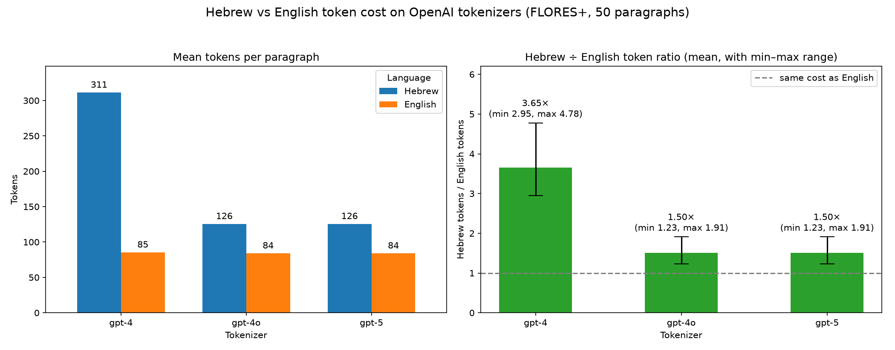

# Hebrew token tax

**Authors:** Priel Krishtal, Liad Albocher

How many more tokens does Hebrew cost than English for the same content, on commercial LLM tokenizers? API pricing is per token, so more tokens means a higher bill.

## Hypotheses

- **H1:** for the same content, Hebrew needs more tokens than English (ratio > 1) on every tokenizer we test.
- **H2:** newer tokenizers narrow that gap.

The ratio is Hebrew tokens divided by English tokens, per paragraph. We use the ratio and not the difference because paragraph length varies, and a difference grows with length while a ratio does not.

## Method

- **Data:** FLORES+ dev split (`openlanguagedata/flores_plus`), Hebrew and English versions of the same sentences. Sentences are grouped by source article into paragraphs, and 50 paragraphs are sampled (seed 42).
- **Counting:** token counts only, with free methods (tiktoken runs offline). No paid generation calls. The FLORES text itself is not saved or published; the results file holds counts only.
- **Notebook:** [notebooks/01_tokenizer_ratio_baseline.ipynb](notebooks/01_tokenizer_ratio_baseline.ipynb)

## Results so far (OpenAI only)

<!-- Update when Claude and Gemini counters are added. -->

| Tokenizer | Mean ratio | Min – max | Hebrew chars/token | English chars/token |
|---|---|---|---|---|
| `gpt-4` (`cl100k_base`) | 3.65 | 2.95 – 4.78 | 1.05 | 4.86 |
| `gpt-4o` (`o200k_base`) | 1.50 | 1.23 – 1.91 | 2.58 | 4.93 |
| `gpt-5` (`o200k_base`)* | 1.50 | 1.23 – 1.91 | 2.58 | 4.93 |

\* `tiktoken` maps `gpt-5` to the same tokenizer as `gpt-4o`, so its numbers are identical by construction. It is not an independent measurement.

Hebrew costs more than English on every OpenAI tokenizer tested, which fits H1. The gap shrank from 3.65× to 1.50× between `gpt-4` and `gpt-4o`, which fits H2 for OpenAI. Limits: one dataset, 50 paragraphs, one vendor so far. Raw per-paragraph counts are in [results/01_tokenizer_counts.csv](results/01_tokenizer_counts.csv).

