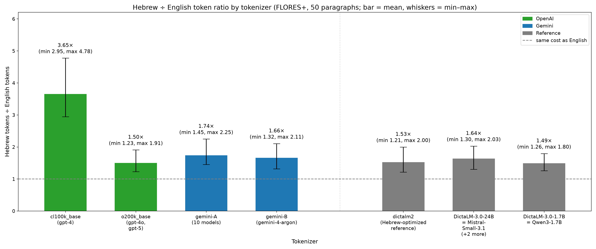

<div align="center">

  <h1> Hebrew Prompt Compression</h1>

  <p>
    <strong>Cut LLM token costs for Hebrew chatbots with a small local model that deletes low-value words and prefixes, without losing the facts that matter.</strong>
  </p>

  <p>
    
    
    
  </p>

  <p>
    <sub>
      <strong>Developed by:</strong> Priel Krishtal & Liad Albocher
      <br>
      <strong>Academic Advisor:</strong> Dr. Yair Even-Zohar
    </sub>
  </p>

</div>


## Why

Hebrew costs about **1.5× more tokens than English** on current LLM tokenizers. Customer-service chatbots resend the conversation history and retrieved documents on every call, so Hebrew-speaking businesses pay that premium again and again. Existing compressors are trained on English. In our tests the standard tool, LLMLingua-2, loses accuracy in Hebrew, mostly on negations and conditions.



## What we're building

A compressor that runs locally between a chatbot backend and the LLM API, and shortens each request before it is sent:

```
chat history + retrieved docs ──► [ Hebrew compressor ] ──► shorter prompt ──► LLM API
                                     │
                                     ├─ splits words into morphemes (ו + ה + לקוח)
                                     ├─ keeps or drops each unit (small Hebrew BERT)
                                     └─ always keeps numbers, dates, names, negations
```

- **Deletion only:** the compressor never rewrites, so it cannot invent facts.
- **Morpheme-level:** Hebrew prefixes (ו ה ש ב ל כ מ) are separate units, which word-level tools can't handle.
- **Distilled:** a strong LLM "teacher" compresses many examples; a small student model learns to copy its decisions and runs in milliseconds, with no LLM call.

## Feasibility (done)

Before building, we tested whether the idea holds on 48 Hebrew and 48 English synthetic customer-service cases. At ~50% compression in Hebrew, an LLM teacher kept accuracy at 94–95% (same as the uncompressed text), while LLMLingua-2 dropped to 86% and translate-then-compress dropped to 69%. In English, LLMLingua-2 already works well, so the gap is specific to Hebrew. Details, notebooks and results are in [`feasibility/`](feasibility/).

## Status

| Stage | State |
|---|---|
| Token-cost measurement (Hebrew vs English) | ✅ Done |
| Feasibility test: baselines vs. LLM teacher | ✅ Done |
| Teacher selection (open-weight, license allows distillation) | 🔄 In progress |
| Label generation + morpheme round-trip check | ⏳ Next |
| Student model training (DictaBERT) | ⏳ Planned |
| Evaluation vs. LLMLingua-2 | ⏳ Planned |
| Local proxy (FastAPI) | ⏳ Planned |


## License

TBD.