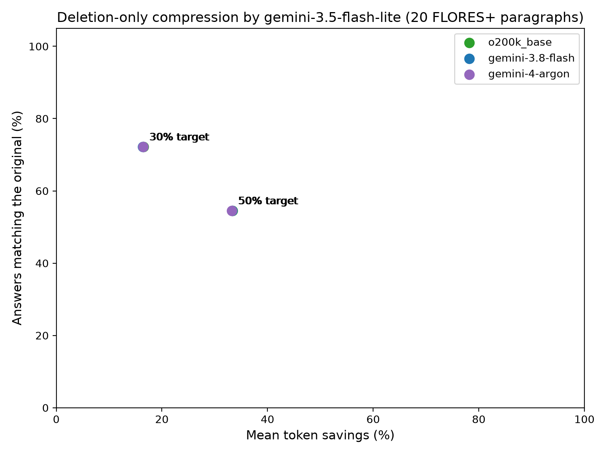

# 02 — Oracle compression, `_lite` run

## What we tested

For each of 20 Hebrew paragraphs:
1. Compress: Gemini deletes words to make the paragraph 30% shorter,
   then again for 50%.
2. Count: how many tokens did that save on GPT and Gemini?
3. Questions: Gemini writes 3 questions about the original paragraph.
4. Answer: Gemini answers them from the original and from the
   shortened versions.
5. Judge: do the answers match?

## Setup

| Step | Model |
|---|---|
| Compress (deletion only, temperature 0) | `gemini-3.5-flash-lite` |
| Questions, answers, judge | `gemini-3.5-flash-lite` |
| Token counts | `o200k_base` (GPT-4o), `gemini-3.8-flash`, `gemini-4-argon` (`count_tokens`) |

- Data: first 20 paragraphs of notebook 01's FLORES+ dev sample (50 paragraphs, seed 42).
- Targets: delete ~30% and ~50% of the words.
- A compression is valid only if its kept words are an in-order subsequence of the original
  words (punctuation ignored). Invalid compressions are excluded from the averages and the
  quality check.

## Results

Means over valid compressions only.

| Target | Valid | Word reduction | o200k savings | gemini‑3.8 savings | argon savings | Match | Partial | Mismatch | Violations |
|---|---|---|---|---|---|---|---|---|---|
| 30% | 12 / 20 | 17.4% | 16.5% | 16.4% | 16.5% | 72.2% | 16.7% | 11.1% | 40.0% |
| 50% | 11 / 20 | 35.5% | 33.4% | 33.3% | 33.2% | 54.5% | 21.2% | 24.2% | 45.0% |

## Pass/fail vs. our bar (~90% match at ≥30% token savings)

| Target | Match ≥ ~90%? | Savings ≥ 30%? | Result |
|---|---|---|---|
| 30% | No (72.2%) | No (~16.5%) | Fail |
| 50% | No (54.5%) | Yes (~33.3%) | Fail |

## Caveats

- The answerer (`gemini-3.5-flash-lite`) missed facts that were still in the compressed text:
  in 2 of the 3 mismatches inspected by hand, the fact was present, but the answer was
  "not in the text".
- Only 12 (30%) and 11 (50%) valid paragraphs per target, so 36 and 33 judged questions.

## Violation counts by class

One class per invalid compression, from its first violating word.

| Class | 30% | 50% | Total |
|---|---|---|---|
| Prefix drop | 1 | 4 | 5 |
| Merge | 4 | 3 | 7 |
| Rewrite | 3 | 2 | 5 |
| **Total** | **8** | **9** | **17** |
