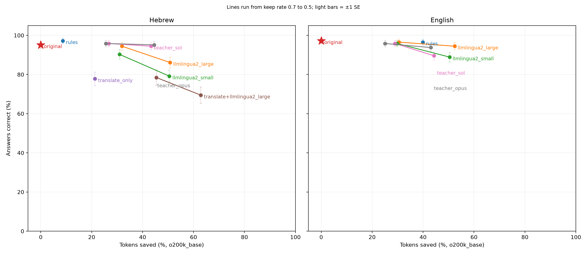
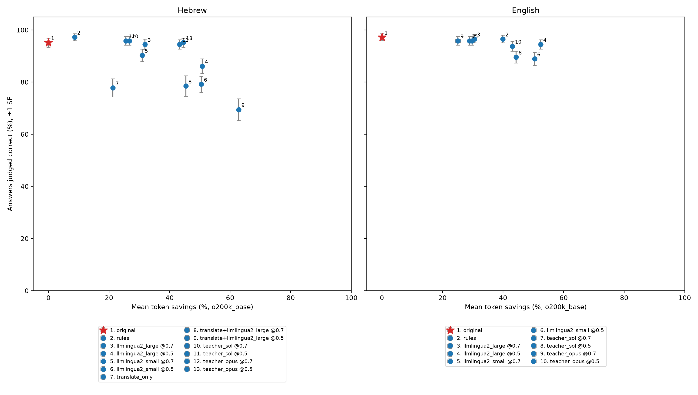
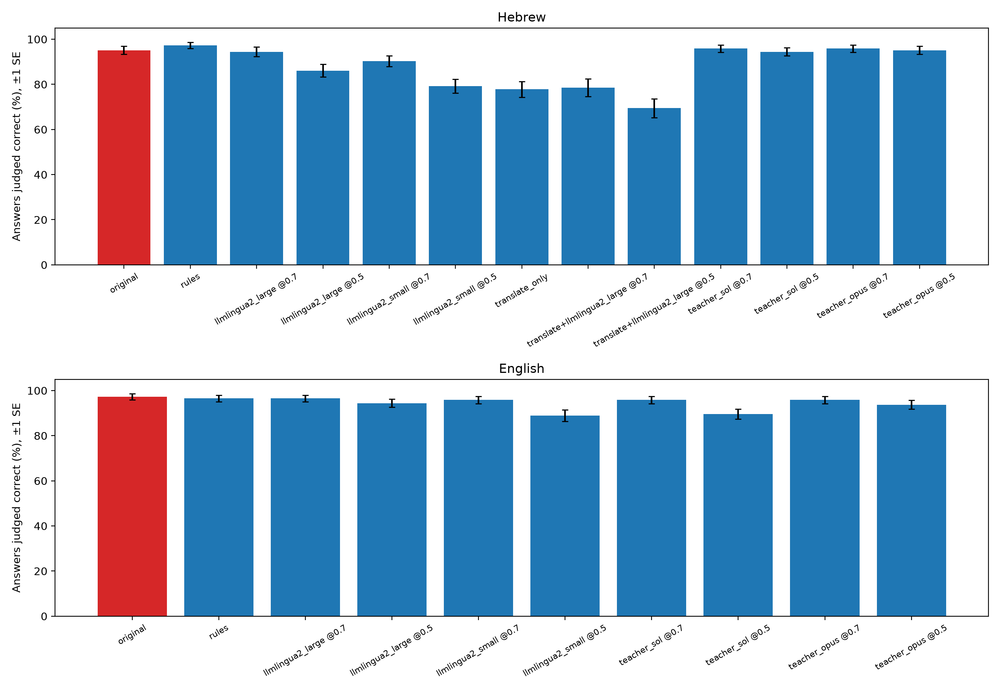
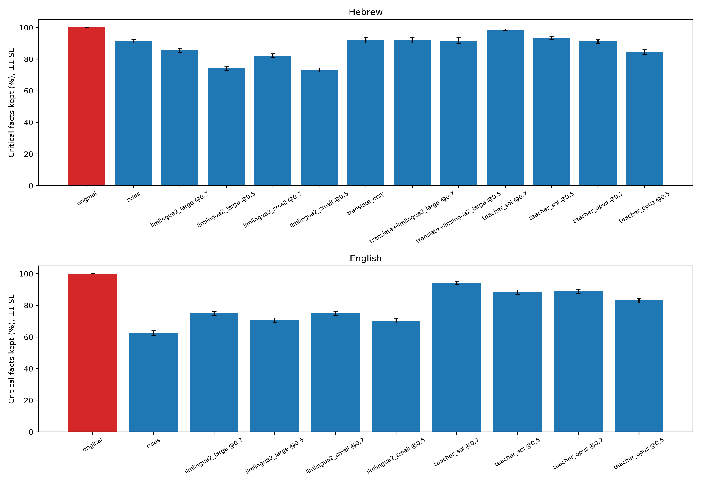

# 03 — Baselines and teachers (Test 3)

## Main chart: tokens saved vs. answers correct

Cases: 48 Hebrew, 48 English. Spec: `notebooks/03_spec.md`. Savings use tiktoken `o200k_base`; error bars are ±1 standard error over cases.

## Hebrew/English token ratio of the originals

- Overall: 1.22 (38533 / 31667 tokens)
- Mean per case: 1.22

## Notes

- facts_kept for translation methods checks digits only and does not detect currency errors (e.g. ש״ח -> dollars).

## (a) Summary

| language | method | rate | cases | savings % | tokens saved per case | accuracy % | accuracy drop vs original | facts kept % | latency ms | teacher failures | JSON failures |
|---|---|---|---|---|---|---|---|---|---|---|---|
| he | original |  | 48 | 0.0 | 0.0 | 95.1 | 0.0 | 100.0 | 0.0 | 0 | 0 |
| he | rules |  | 48 | 8.7 | 73.1 | 97.2 | -2.1 | 91.4 | 2.7 | 0 | 0 |
| he | llmlingua2_large | 0.7 | 48 | 31.9 | 254.5 | 94.4 | 0.7 | 85.7 | 3303.1 | 0 | 0 |
| he | llmlingua2_large | 0.5 | 48 | 50.8 | 407.1 | 86.1 | 9.0 | 74.1 | 4690.1 | 0 | 0 |
| he | llmlingua2_small | 0.7 | 48 | 30.9 | 247.8 | 90.3 | 4.9 | 82.3 | 1229.0 | 0 | 0 |
| he | llmlingua2_small | 0.5 | 48 | 50.5 | 405.1 | 79.2 | 16.0 | 73.1 | 1206.2 | 0 | 0 |
| he | translate_only |  | 48 | 21.3 | 170.5 | 77.8 | 17.4 | 92.0 | 17008.1 | 0 | 0 |
| he | translate+llmlingua2_large | 0.7 | 48 | 45.4 | 364.4 | 78.5 | 16.7 | 92.0 | 21131.8 | 0 | 0 |
| he | translate+llmlingua2_large | 0.5 | 48 | 62.9 | 505.1 | 69.4 | 25.7 | 91.7 | 19924.7 | 0 | 0 |
| he | teacher_sol | 0.7 | 48 | 26.7 | 215.9 | 95.8 | -0.7 | 98.7 |  | 0 | 0 |
| he | teacher_sol | 0.5 | 48 | 43.3 | 349.0 | 94.4 | 0.7 | 93.5 |  | 0 | 0 |
| he | teacher_opus | 0.7 | 48 | 25.6 | 205.2 | 95.8 | -0.7 | 91.1 |  | 0 | 0 |
| he | teacher_opus | 0.5 | 48 | 44.6 | 357.0 | 95.1 | 0.0 | 84.5 |  | 0 | 0 |
| en | original |  | 48 | 0.0 | 0.0 | 97.2 | 0.0 | 100.0 | 0.0 | 0 | 0 |
| en | rules |  | 48 | 39.9 | 268.2 | 96.5 | 0.7 | 62.6 | 1.1 | 0 | 0 |
| en | llmlingua2_large | 0.7 | 48 | 30.5 | 201.4 | 96.5 | 0.7 | 74.9 | 3433.3 | 0 | 0 |
| en | llmlingua2_large | 0.5 | 48 | 52.4 | 346.2 | 94.4 | 2.8 | 70.7 | 3495.1 | 0 | 0 |
| en | llmlingua2_small | 0.7 | 48 | 29.8 | 195.6 | 95.8 | 1.4 | 75.0 | 993.6 | 0 | 0 |
| en | llmlingua2_small | 0.5 | 48 | 50.4 | 332.7 | 88.9 | 8.3 | 70.3 | 974.6 | 0 | 0 |
| en | teacher_sol | 0.7 | 48 | 28.9 | 195.5 | 95.8 | 1.4 | 94.4 |  | 0 | 0 |
| en | teacher_sol | 0.5 | 48 | 44.3 | 294.0 | 89.6 | 7.6 | 88.6 |  | 0 | 0 |
| en | teacher_opus | 0.7 | 48 | 25.1 | 163.9 | 95.8 | 1.4 | 88.8 |  | 2 | 0 |
| en | teacher_opus | 0.5 | 48 | 43.1 | 287.4 | 93.8 | 3.5 | 83.2 |  | 0 | 0 |

## Teacher length: requested vs. actual keep rate (words)

| language | case_id | method | requested_keep | actual_keep | attempts | length_miss | teacher_failed |
|---|---|---|---|---|---|---|---|
| he | ins_01 | teacher_sol | 0.7 | 0.7 | 1 | 0 | 0 |
| he | ins_02 | teacher_sol | 0.7 | 0.7 | 1 | 0 | 0 |
| he | ins_03 | teacher_sol | 0.7 | 0.7 | 1 | 0 | 0 |
| he | ins_04 | teacher_sol | 0.7 | 0.7 | 1 | 0 | 0 |
| he | ins_05 | teacher_sol | 0.7 | 0.7 | 1 | 0 | 0 |
| he | ins_06 | teacher_sol | 0.7 | 0.7 | 1 | 0 | 0 |
| he | ins_07 | teacher_sol | 0.7 | 0.7 | 1 | 0 | 0 |
| he | ins_08 | teacher_sol | 0.7 | 0.7 | 1 | 0 | 0 |
| he | tel_01 | teacher_sol | 0.7 | 0.7 | 1 | 0 | 0 |
| he | tel_02 | teacher_sol | 0.7 | 0.7 | 1 | 0 | 0 |
| he | tel_03 | teacher_sol | 0.7 | 0.7 | 1 | 0 | 0 |
| he | tel_04 | teacher_sol | 0.7 | 0.7 | 1 | 0 | 0 |
| he | tel_05 | teacher_sol | 0.7 | 0.7 | 1 | 0 | 0 |
| he | tel_06 | teacher_sol | 0.7 | 0.7 | 1 | 0 | 0 |
| he | tel_07 | teacher_sol | 0.7 | 0.7 | 1 | 0 | 0 |
| he | tel_08 | teacher_sol | 0.7 | 0.7 | 1 | 0 | 0 |
| he | bank_01 | teacher_sol | 0.7 | 0.7 | 1 | 0 | 0 |
| he | bank_02 | teacher_sol | 0.7 | 0.7 | 1 | 0 | 0 |
| he | bank_03 | teacher_sol | 0.7 | 0.7 | 1 | 0 | 0 |
| he | bank_04 | teacher_sol | 0.7 | 0.7 | 1 | 0 | 0 |
| he | bank_05 | teacher_sol | 0.7 | 0.7 | 1 | 0 | 0 |
| he | bank_06 | teacher_sol | 0.7 | 0.7 | 1 | 0 | 0 |
| he | bank_07 | teacher_sol | 0.7 | 0.7 | 1 | 0 | 0 |
| he | bank_08 | teacher_sol | 0.7 | 0.7 | 1 | 0 | 0 |
| he | health_01 | teacher_sol | 0.7 | 0.7 | 1 | 0 | 0 |
| he | health_02 | teacher_sol | 0.7 | 0.7 | 1 | 0 | 0 |
| he | health_03 | teacher_sol | 0.7 | 0.7 | 1 | 0 | 0 |
| he | health_04 | teacher_sol | 0.7 | 0.7 | 1 | 0 | 0 |
| he | health_05 | teacher_sol | 0.7 | 0.7 | 1 | 0 | 0 |
| he | health_06 | teacher_sol | 0.7 | 0.7 | 1 | 0 | 0 |
| he | health_07 | teacher_sol | 0.7 | 0.7 | 1 | 0 | 0 |
| he | health_08 | teacher_sol | 0.7 | 0.7 | 1 | 0 | 0 |
| he | shop_01 | teacher_sol | 0.7 | 0.7 | 1 | 0 | 0 |
| he | shop_02 | teacher_sol | 0.7 | 0.7 | 1 | 0 | 0 |
| he | shop_03 | teacher_sol | 0.7 | 0.7 | 1 | 0 | 0 |
| he | shop_04 | teacher_sol | 0.7 | 0.7 | 1 | 0 | 0 |
| he | shop_05 | teacher_sol | 0.7 | 0.7 | 1 | 0 | 0 |
| he | shop_06 | teacher_sol | 0.7 | 0.7 | 1 | 0 | 0 |
| he | shop_07 | teacher_sol | 0.7 | 0.7 | 1 | 0 | 0 |
| he | shop_08 | teacher_sol | 0.7 | 0.7 | 1 | 0 | 0 |
| he | util_01 | teacher_sol | 0.7 | 0.7 | 1 | 0 | 0 |
| he | util_02 | teacher_sol | 0.7 | 0.7 | 1 | 0 | 0 |
| he | util_03 | teacher_sol | 0.7 | 0.7 | 1 | 0 | 0 |
| he | util_04 | teacher_sol | 0.7 | 0.7 | 1 | 0 | 0 |
| he | util_05 | teacher_sol | 0.7 | 0.7 | 1 | 0 | 0 |
| he | util_06 | teacher_sol | 0.7 | 0.7 | 1 | 0 | 0 |
| he | util_07 | teacher_sol | 0.7 | 0.7 | 1 | 0 | 0 |
| he | util_08 | teacher_sol | 0.7 | 0.7 | 1 | 0 | 0 |
| he | ins_01 | teacher_sol | 0.5 | 0.5 | 1 | 0 | 0 |
| he | ins_02 | teacher_sol | 0.5 | 0.5 | 1 | 0 | 0 |
| he | ins_03 | teacher_sol | 0.5 | 0.5 | 1 | 0 | 0 |
| he | ins_04 | teacher_sol | 0.5 | 0.5 | 1 | 0 | 0 |
| he | ins_05 | teacher_sol | 0.5 | 0.5 | 1 | 0 | 0 |
| he | ins_06 | teacher_sol | 0.5 | 0.5 | 1 | 0 | 0 |
| he | ins_07 | teacher_sol | 0.5 | 0.5 | 1 | 0 | 0 |
| he | ins_08 | teacher_sol | 0.5 | 0.5 | 1 | 0 | 0 |
| he | tel_01 | teacher_sol | 0.5 | 0.6 | 1 | 0 | 0 |
| he | tel_02 | teacher_sol | 0.5 | 0.5 | 1 | 0 | 0 |
| he | tel_03 | teacher_sol | 0.5 | 0.5 | 1 | 0 | 0 |
| he | tel_04 | teacher_sol | 0.5 | 0.6 | 1 | 0 | 0 |
| he | tel_05 | teacher_sol | 0.5 | 0.5 | 1 | 0 | 0 |
| he | tel_06 | teacher_sol | 0.5 | 0.5 | 1 | 0 | 0 |
| he | tel_07 | teacher_sol | 0.5 | 0.5 | 1 | 0 | 0 |
| he | tel_08 | teacher_sol | 0.5 | 0.5 | 1 | 0 | 0 |
| he | bank_01 | teacher_sol | 0.5 | 0.5 | 1 | 0 | 0 |
| he | bank_02 | teacher_sol | 0.5 | 0.5 | 1 | 0 | 0 |
| he | bank_03 | teacher_sol | 0.5 | 0.6 | 1 | 0 | 0 |
| he | bank_04 | teacher_sol | 0.5 | 0.5 | 1 | 0 | 0 |
| he | bank_05 | teacher_sol | 0.5 | 0.5 | 1 | 0 | 0 |
| he | bank_06 | teacher_sol | 0.5 | 0.5 | 1 | 0 | 0 |
| he | bank_07 | teacher_sol | 0.5 | 0.5 | 1 | 0 | 0 |
| he | bank_08 | teacher_sol | 0.5 | 0.5 | 1 | 0 | 0 |
| he | health_01 | teacher_sol | 0.5 | 0.5 | 1 | 0 | 0 |
| he | health_02 | teacher_sol | 0.5 | 0.6 | 1 | 0 | 0 |
| he | health_03 | teacher_sol | 0.5 | 0.5 | 1 | 0 | 0 |
| he | health_04 | teacher_sol | 0.5 | 0.5 | 1 | 0 | 0 |
| he | health_05 | teacher_sol | 0.5 | 0.5 | 1 | 0 | 0 |
| he | health_06 | teacher_sol | 0.5 | 0.5 | 1 | 0 | 0 |
| he | health_07 | teacher_sol | 0.5 | 0.5 | 1 | 0 | 0 |
| he | health_08 | teacher_sol | 0.5 | 0.5 | 1 | 0 | 0 |
| he | shop_01 | teacher_sol | 0.5 | 0.5 | 1 | 0 | 0 |
| he | shop_02 | teacher_sol | 0.5 | 0.5 | 1 | 0 | 0 |
| he | shop_03 | teacher_sol | 0.5 | 0.5 | 1 | 0 | 0 |
| he | shop_04 | teacher_sol | 0.5 | 0.6 | 1 | 0 | 0 |
| he | shop_05 | teacher_sol | 0.5 | 0.5 | 2 | 0 | 0 |
| he | shop_06 | teacher_sol | 0.5 | 0.6 | 1 | 0 | 0 |
| he | shop_07 | teacher_sol | 0.5 | 0.6 | 1 | 0 | 0 |
| he | shop_08 | teacher_sol | 0.5 | 0.5 | 1 | 0 | 0 |
| he | util_01 | teacher_sol | 0.5 | 0.5 | 1 | 0 | 0 |
| he | util_02 | teacher_sol | 0.5 | 0.5 | 1 | 0 | 0 |
| he | util_03 | teacher_sol | 0.5 | 0.5 | 1 | 0 | 0 |
| he | util_04 | teacher_sol | 0.5 | 0.6 | 1 | 0 | 0 |
| he | util_05 | teacher_sol | 0.5 | 0.5 | 1 | 0 | 0 |
| he | util_06 | teacher_sol | 0.5 | 0.5 | 1 | 0 | 0 |
| he | util_07 | teacher_sol | 0.5 | 0.5 | 1 | 0 | 0 |
| he | util_08 | teacher_sol | 0.5 | 0.5 | 1 | 0 | 0 |
| he | ins_01 | teacher_opus | 0.7 | 0.7 | 1 | 0 | 0 |
| he | ins_02 | teacher_opus | 0.7 | 0.7 | 1 | 0 | 0 |
| he | ins_03 | teacher_opus | 0.7 | 0.7 | 1 | 0 | 0 |
| he | ins_04 | teacher_opus | 0.7 | 0.7 | 1 | 0 | 0 |
| he | ins_05 | teacher_opus | 0.7 | 0.7 | 1 | 0 | 0 |
| he | ins_06 | teacher_opus | 0.7 | 0.7 | 1 | 0 | 0 |
| he | ins_07 | teacher_opus | 0.7 | 0.7 | 1 | 0 | 0 |
| he | ins_08 | teacher_opus | 0.7 | 0.7 | 1 | 0 | 0 |
| he | tel_01 | teacher_opus | 0.7 | 0.7 | 1 | 0 | 0 |
| he | tel_02 | teacher_opus | 0.7 | 0.7 | 1 | 0 | 0 |
| he | tel_03 | teacher_opus | 0.7 | 0.7 | 1 | 0 | 0 |
| he | tel_04 | teacher_opus | 0.7 | 0.7 | 1 | 0 | 0 |
| he | tel_05 | teacher_opus | 0.7 | 0.7 | 1 | 0 | 0 |
| he | tel_06 | teacher_opus | 0.7 | 0.7 | 1 | 0 | 0 |
| he | tel_07 | teacher_opus | 0.7 | 0.7 | 1 | 0 | 0 |
| he | tel_08 | teacher_opus | 0.7 | 0.7 | 1 | 0 | 0 |
| he | bank_01 | teacher_opus | 0.7 | 0.7 | 1 | 0 | 0 |
| he | bank_02 | teacher_opus | 0.7 | 0.7 | 1 | 0 | 0 |
| he | bank_03 | teacher_opus | 0.7 | 0.7 | 1 | 0 | 0 |
| he | bank_04 | teacher_opus | 0.7 | 0.7 | 1 | 0 | 0 |
| he | bank_05 | teacher_opus | 0.7 | 0.7 | 1 | 0 | 0 |
| he | bank_06 | teacher_opus | 0.7 | 0.7 | 1 | 0 | 0 |
| he | bank_07 | teacher_opus | 0.7 | 0.7 | 1 | 0 | 0 |
| he | bank_08 | teacher_opus | 0.7 | 0.7 | 1 | 0 | 0 |
| he | health_01 | teacher_opus | 0.7 | 0.7 | 1 | 0 | 0 |
| he | health_02 | teacher_opus | 0.7 | 0.7 | 1 | 0 | 0 |
| he | health_03 | teacher_opus | 0.7 | 0.7 | 1 | 0 | 0 |
| he | health_04 | teacher_opus | 0.7 | 0.7 | 1 | 0 | 0 |
| he | health_05 | teacher_opus | 0.7 | 0.7 | 1 | 0 | 0 |
| he | health_06 | teacher_opus | 0.7 | 0.7 | 1 | 0 | 0 |
| he | health_07 | teacher_opus | 0.7 | 0.7 | 1 | 0 | 0 |
| he | health_08 | teacher_opus | 0.7 | 0.7 | 1 | 0 | 0 |
| he | shop_01 | teacher_opus | 0.7 | 0.7 | 1 | 0 | 0 |
| he | shop_02 | teacher_opus | 0.7 | 0.7 | 1 | 0 | 0 |
| he | shop_03 | teacher_opus | 0.7 | 0.7 | 1 | 0 | 0 |
| he | shop_04 | teacher_opus | 0.7 | 0.7 | 1 | 0 | 0 |
| he | shop_05 | teacher_opus | 0.7 | 0.7 | 1 | 0 | 0 |
| he | shop_06 | teacher_opus | 0.7 | 0.7 | 1 | 0 | 0 |
| he | shop_07 | teacher_opus | 0.7 | 0.7 | 1 | 0 | 0 |
| he | shop_08 | teacher_opus | 0.7 | 0.7 | 1 | 0 | 0 |
| he | util_01 | teacher_opus | 0.7 | 0.7 | 1 | 0 | 0 |
| he | util_02 | teacher_opus | 0.7 | 0.7 | 1 | 0 | 0 |
| he | util_03 | teacher_opus | 0.7 | 0.7 | 1 | 0 | 0 |
| he | util_04 | teacher_opus | 0.7 | 0.7 | 1 | 0 | 0 |
| he | util_05 | teacher_opus | 0.7 | 0.7 | 1 | 0 | 0 |
| he | util_06 | teacher_opus | 0.7 | 0.7 | 1 | 0 | 0 |
| he | util_07 | teacher_opus | 0.7 | 0.7 | 1 | 0 | 0 |
| he | util_08 | teacher_opus | 0.7 | 0.7 | 1 | 0 | 0 |
| he | ins_01 | teacher_opus | 0.5 | 0.6 | 1 | 0 | 0 |
| he | ins_02 | teacher_opus | 0.5 | 0.5 | 1 | 0 | 0 |
| he | ins_03 | teacher_opus | 0.5 | 0.5 | 1 | 0 | 0 |
| he | ins_04 | teacher_opus | 0.5 | 0.5 | 1 | 0 | 0 |
| he | ins_05 | teacher_opus | 0.5 | 0.5 | 1 | 0 | 0 |
| he | ins_06 | teacher_opus | 0.5 | 0.5 | 1 | 0 | 0 |
| he | ins_07 | teacher_opus | 0.5 | 0.5 | 1 | 0 | 0 |
| he | ins_08 | teacher_opus | 0.5 | 0.5 | 1 | 0 | 0 |
| he | tel_01 | teacher_opus | 0.5 | 0.5 | 1 | 0 | 0 |
| he | tel_02 | teacher_opus | 0.5 | 0.5 | 1 | 0 | 0 |
| he | tel_03 | teacher_opus | 0.5 | 0.5 | 1 | 0 | 0 |
| he | tel_04 | teacher_opus | 0.5 | 0.5 | 1 | 0 | 0 |
| he | tel_05 | teacher_opus | 0.5 | 0.5 | 1 | 0 | 0 |
| he | tel_06 | teacher_opus | 0.5 | 0.5 | 1 | 0 | 0 |
| he | tel_07 | teacher_opus | 0.5 | 0.5 | 1 | 0 | 0 |
| he | tel_08 | teacher_opus | 0.5 | 0.6 | 1 | 0 | 0 |
| he | bank_01 | teacher_opus | 0.5 | 0.5 | 1 | 0 | 0 |
| he | bank_02 | teacher_opus | 0.5 | 0.5 | 1 | 0 | 0 |
| he | bank_03 | teacher_opus | 0.5 | 0.5 | 1 | 0 | 0 |
| he | bank_04 | teacher_opus | 0.5 | 0.5 | 1 | 0 | 0 |
| he | bank_05 | teacher_opus | 0.5 | 0.5 | 1 | 0 | 0 |
| he | bank_06 | teacher_opus | 0.5 | 0.5 | 1 | 0 | 0 |
| he | bank_07 | teacher_opus | 0.5 | 0.5 | 1 | 0 | 0 |
| he | bank_08 | teacher_opus | 0.5 | 0.5 | 1 | 0 | 0 |
| he | health_01 | teacher_opus | 0.5 | 0.5 | 1 | 0 | 0 |
| he | health_02 | teacher_opus | 0.5 | 0.5 | 1 | 0 | 0 |
| he | health_03 | teacher_opus | 0.5 | 0.5 | 1 | 0 | 0 |
| he | health_04 | teacher_opus | 0.5 | 0.5 | 1 | 0 | 0 |
| he | health_05 | teacher_opus | 0.5 | 0.5 | 1 | 0 | 0 |
| he | health_06 | teacher_opus | 0.5 | 0.5 | 1 | 0 | 0 |
| he | health_07 | teacher_opus | 0.5 | 0.5 | 1 | 0 | 0 |
| he | health_08 | teacher_opus | 0.5 | 0.5 | 1 | 0 | 0 |
| he | shop_01 | teacher_opus | 0.5 | 0.5 | 1 | 0 | 0 |
| he | shop_02 | teacher_opus | 0.5 | 0.5 | 1 | 0 | 0 |
| he | shop_03 | teacher_opus | 0.5 | 0.5 | 1 | 0 | 0 |
| he | shop_04 | teacher_opus | 0.5 | 0.5 | 1 | 0 | 0 |
| he | shop_05 | teacher_opus | 0.5 | 0.5 | 1 | 0 | 0 |
| he | shop_06 | teacher_opus | 0.5 | 0.5 | 1 | 0 | 0 |
| he | shop_07 | teacher_opus | 0.5 | 0.5 | 1 | 0 | 0 |
| he | shop_08 | teacher_opus | 0.5 | 0.5 | 1 | 0 | 0 |
| he | util_01 | teacher_opus | 0.5 | 0.5 | 1 | 0 | 0 |
| he | util_02 | teacher_opus | 0.5 | 0.5 | 1 | 0 | 0 |
| he | util_03 | teacher_opus | 0.5 | 0.5 | 1 | 0 | 0 |
| he | util_04 | teacher_opus | 0.5 | 0.5 | 1 | 0 | 0 |
| he | util_05 | teacher_opus | 0.5 | 0.5 | 1 | 0 | 0 |
| he | util_06 | teacher_opus | 0.5 | 0.5 | 3 | 0 | 0 |
| he | util_07 | teacher_opus | 0.5 | 0.6 | 1 | 0 | 0 |
| he | util_08 | teacher_opus | 0.5 | 0.5 | 1 | 0 | 0 |
| en | ins_01 | teacher_sol | 0.7 | 0.7 | 1 | 0 | 0 |
| en | ins_02 | teacher_sol | 0.7 | 0.7 | 1 | 0 | 0 |
| en | ins_03 | teacher_sol | 0.7 | 0.7 | 1 | 0 | 0 |
| en | ins_04 | teacher_sol | 0.7 | 0.7 | 1 | 0 | 0 |
| en | ins_05 | teacher_sol | 0.7 | 0.7 | 1 | 0 | 0 |
| en | ins_06 | teacher_sol | 0.7 | 0.7 | 1 | 0 | 0 |
| en | ins_07 | teacher_sol | 0.7 | 0.7 | 1 | 0 | 0 |
| en | ins_08 | teacher_sol | 0.7 | 0.6 | 1 | 0 | 0 |
| en | tel_01 | teacher_sol | 0.7 | 0.7 | 1 | 0 | 0 |
| en | tel_02 | teacher_sol | 0.7 | 0.7 | 1 | 0 | 0 |
| en | tel_03 | teacher_sol | 0.7 | 0.6 | 1 | 0 | 0 |
| en | tel_04 | teacher_sol | 0.7 | 0.7 | 1 | 0 | 0 |
| en | tel_05 | teacher_sol | 0.7 | 0.7 | 1 | 0 | 0 |
| en | tel_06 | teacher_sol | 0.7 | 0.7 | 1 | 0 | 0 |
| en | tel_07 | teacher_sol | 0.7 | 0.7 | 1 | 0 | 0 |
| en | tel_08 | teacher_sol | 0.7 | 0.7 | 1 | 0 | 0 |
| en | bank_01 | teacher_sol | 0.7 | 0.7 | 1 | 0 | 0 |
| en | bank_02 | teacher_sol | 0.7 | 0.7 | 1 | 0 | 0 |
| en | bank_03 | teacher_sol | 0.7 | 0.6 | 1 | 0 | 0 |
| en | bank_04 | teacher_sol | 0.7 | 0.7 | 1 | 0 | 0 |
| en | bank_05 | teacher_sol | 0.7 | 0.7 | 1 | 0 | 0 |
| en | bank_06 | teacher_sol | 0.7 | 0.7 | 1 | 0 | 0 |
| en | bank_07 | teacher_sol | 0.7 | 0.7 | 1 | 0 | 0 |
| en | bank_08 | teacher_sol | 0.7 | 0.6 | 1 | 0 | 0 |
| en | health_01 | teacher_sol | 0.7 | 0.7 | 1 | 0 | 0 |
| en | health_02 | teacher_sol | 0.7 | 0.7 | 1 | 0 | 0 |
| en | health_03 | teacher_sol | 0.7 | 0.6 | 1 | 0 | 0 |
| en | health_04 | teacher_sol | 0.7 | 0.7 | 1 | 0 | 0 |
| en | health_05 | teacher_sol | 0.7 | 0.7 | 1 | 0 | 0 |
| en | health_06 | teacher_sol | 0.7 | 0.7 | 1 | 0 | 0 |
| en | health_07 | teacher_sol | 0.7 | 0.7 | 1 | 0 | 0 |
| en | health_08 | teacher_sol | 0.7 | 0.7 | 1 | 0 | 0 |
| en | shop_01 | teacher_sol | 0.7 | 0.7 | 1 | 0 | 0 |
| en | shop_02 | teacher_sol | 0.7 | 0.7 | 1 | 0 | 0 |
| en | shop_03 | teacher_sol | 0.7 | 0.7 | 1 | 0 | 0 |
| en | shop_04 | teacher_sol | 0.7 | 0.7 | 1 | 0 | 0 |
| en | shop_05 | teacher_sol | 0.7 | 0.7 | 1 | 0 | 0 |
| en | shop_06 | teacher_sol | 0.7 | 0.7 | 1 | 0 | 0 |
| en | shop_07 | teacher_sol | 0.7 | 0.7 | 1 | 0 | 0 |
| en | shop_08 | teacher_sol | 0.7 | 0.7 | 1 | 0 | 0 |
| en | util_01 | teacher_sol | 0.7 | 0.7 | 1 | 0 | 0 |
| en | util_02 | teacher_sol | 0.7 | 0.7 | 1 | 0 | 0 |
| en | util_03 | teacher_sol | 0.7 | 0.7 | 1 | 0 | 0 |
| en | util_04 | teacher_sol | 0.7 | 0.7 | 1 | 0 | 0 |
| en | util_05 | teacher_sol | 0.7 | 0.7 | 1 | 0 | 0 |
| en | util_06 | teacher_sol | 0.7 | 0.7 | 1 | 0 | 0 |
| en | util_07 | teacher_sol | 0.7 | 0.7 | 1 | 0 | 0 |
| en | util_08 | teacher_sol | 0.7 | 0.7 | 1 | 0 | 0 |
| en | ins_01 | teacher_sol | 0.5 | 0.5 | 1 | 0 | 0 |
| en | ins_02 | teacher_sol | 0.5 | 0.5 | 1 | 0 | 0 |
| en | ins_03 | teacher_sol | 0.5 | 0.5 | 1 | 0 | 0 |
| en | ins_04 | teacher_sol | 0.5 | 0.5 | 1 | 0 | 0 |
| en | ins_05 | teacher_sol | 0.5 | 0.5 | 1 | 0 | 0 |
| en | ins_06 | teacher_sol | 0.5 | 0.5 | 1 | 0 | 0 |
| en | ins_07 | teacher_sol | 0.5 | 0.5 | 1 | 0 | 0 |
| en | ins_08 | teacher_sol | 0.5 | 0.5 | 1 | 0 | 0 |
| en | tel_01 | teacher_sol | 0.5 | 0.5 | 1 | 0 | 0 |
| en | tel_02 | teacher_sol | 0.5 | 0.5 | 1 | 0 | 0 |
| en | tel_03 | teacher_sol | 0.5 | 0.5 | 1 | 0 | 0 |
| en | tel_04 | teacher_sol | 0.5 | 0.5 | 1 | 0 | 0 |
| en | tel_05 | teacher_sol | 0.5 | 0.6 | 1 | 0 | 0 |
| en | tel_06 | teacher_sol | 0.5 | 0.5 | 1 | 0 | 0 |
| en | tel_07 | teacher_sol | 0.5 | 0.5 | 1 | 0 | 0 |
| en | tel_08 | teacher_sol | 0.5 | 0.5 | 1 | 0 | 0 |
| en | bank_01 | teacher_sol | 0.5 | 0.5 | 1 | 0 | 0 |
| en | bank_02 | teacher_sol | 0.5 | 0.5 | 1 | 0 | 0 |
| en | bank_03 | teacher_sol | 0.5 | 0.5 | 1 | 0 | 0 |
| en | bank_04 | teacher_sol | 0.5 | 0.5 | 1 | 0 | 0 |
| en | bank_05 | teacher_sol | 0.5 | 0.5 | 1 | 0 | 0 |
| en | bank_06 | teacher_sol | 0.5 | 0.5 | 1 | 0 | 0 |
| en | bank_07 | teacher_sol | 0.5 | 0.5 | 1 | 0 | 0 |
| en | bank_08 | teacher_sol | 0.5 | 0.5 | 1 | 0 | 0 |
| en | health_01 | teacher_sol | 0.5 | 0.5 | 1 | 0 | 0 |
| en | health_02 | teacher_sol | 0.5 | 0.5 | 1 | 0 | 0 |
| en | health_03 | teacher_sol | 0.5 | 0.5 | 1 | 0 | 0 |
| en | health_04 | teacher_sol | 0.5 | 0.5 | 1 | 0 | 0 |
| en | health_05 | teacher_sol | 0.5 | 0.5 | 1 | 0 | 0 |
| en | health_06 | teacher_sol | 0.5 | 0.5 | 1 | 0 | 0 |
| en | health_07 | teacher_sol | 0.5 | 0.5 | 1 | 0 | 0 |
| en | health_08 | teacher_sol | 0.5 | 0.5 | 1 | 0 | 0 |
| en | shop_01 | teacher_sol | 0.5 | 0.5 | 1 | 0 | 0 |
| en | shop_02 | teacher_sol | 0.5 | 0.5 | 1 | 0 | 0 |
| en | shop_03 | teacher_sol | 0.5 | 0.5 | 1 | 0 | 0 |
| en | shop_04 | teacher_sol | 0.5 | 0.5 | 1 | 0 | 0 |
| en | shop_05 | teacher_sol | 0.5 | 0.5 | 1 | 0 | 0 |
| en | shop_06 | teacher_sol | 0.5 | 0.5 | 1 | 0 | 0 |
| en | shop_07 | teacher_sol | 0.5 | 0.5 | 1 | 0 | 0 |
| en | shop_08 | teacher_sol | 0.5 | 0.5 | 1 | 0 | 0 |
| en | util_01 | teacher_sol | 0.5 | 0.5 | 1 | 0 | 0 |
| en | util_02 | teacher_sol | 0.5 | 0.5 | 1 | 0 | 0 |
| en | util_03 | teacher_sol | 0.5 | 0.5 | 1 | 0 | 0 |
| en | util_04 | teacher_sol | 0.5 | 0.5 | 1 | 0 | 0 |
| en | util_05 | teacher_sol | 0.5 | 0.5 | 1 | 0 | 0 |
| en | util_06 | teacher_sol | 0.5 | 0.5 | 1 | 0 | 0 |
| en | util_07 | teacher_sol | 0.5 | 0.6 | 1 | 0 | 0 |
| en | util_08 | teacher_sol | 0.5 | 0.5 | 1 | 0 | 0 |
| en | ins_01 | teacher_opus | 0.7 | 0.7 | 1 | 0 | 0 |
| en | ins_02 | teacher_opus | 0.7 | 0.7 | 1 | 0 | 0 |
| en | ins_03 | teacher_opus | 0.7 | 0.7 | 1 | 0 | 0 |
| en | ins_04 | teacher_opus | 0.7 | 0.7 | 1 | 0 | 0 |
| en | ins_05 | teacher_opus | 0.7 | 0.7 | 1 | 0 | 0 |
| en | ins_06 | teacher_opus | 0.7 | 0.7 | 1 | 0 | 0 |
| en | ins_07 | teacher_opus | 0.7 | 1.0 | 3 | 0 | 1 |
| en | ins_08 | teacher_opus | 0.7 | 0.7 | 1 | 0 | 0 |
| en | tel_01 | teacher_opus | 0.7 | 0.7 | 1 | 0 | 0 |
| en | tel_02 | teacher_opus | 0.7 | 0.7 | 1 | 0 | 0 |
| en | tel_03 | teacher_opus | 0.7 | 0.7 | 1 | 0 | 0 |
| en | tel_04 | teacher_opus | 0.7 | 0.7 | 1 | 0 | 0 |
| en | tel_05 | teacher_opus | 0.7 | 0.7 | 1 | 0 | 0 |
| en | tel_06 | teacher_opus | 0.7 | 0.7 | 1 | 0 | 0 |
| en | tel_07 | teacher_opus | 0.7 | 0.7 | 1 | 0 | 0 |
| en | tel_08 | teacher_opus | 0.7 | 0.7 | 1 | 0 | 0 |
| en | bank_01 | teacher_opus | 0.7 | 0.7 | 1 | 0 | 0 |
| en | bank_02 | teacher_opus | 0.7 | 0.7 | 1 | 0 | 0 |
| en | bank_03 | teacher_opus | 0.7 | 0.7 | 1 | 0 | 0 |
| en | bank_04 | teacher_opus | 0.7 | 0.7 | 1 | 0 | 0 |
| en | bank_05 | teacher_opus | 0.7 | 0.7 | 1 | 0 | 0 |
| en | bank_06 | teacher_opus | 0.7 | 0.7 | 1 | 0 | 0 |
| en | bank_07 | teacher_opus | 0.7 | 0.7 | 1 | 0 | 0 |
| en | bank_08 | teacher_opus | 0.7 | 0.7 | 1 | 0 | 0 |
| en | health_01 | teacher_opus | 0.7 | 0.7 | 1 | 0 | 0 |
| en | health_02 | teacher_opus | 0.7 | 0.7 | 1 | 0 | 0 |
| en | health_03 | teacher_opus | 0.7 | 0.7 | 1 | 0 | 0 |
| en | health_04 | teacher_opus | 0.7 | 0.7 | 1 | 0 | 0 |
| en | health_05 | teacher_opus | 0.7 | 0.7 | 1 | 0 | 0 |
| en | health_06 | teacher_opus | 0.7 | 0.7 | 1 | 0 | 0 |
| en | health_07 | teacher_opus | 0.7 | 0.7 | 1 | 0 | 0 |
| en | health_08 | teacher_opus | 0.7 | 0.8 | 1 | 0 | 0 |
| en | shop_01 | teacher_opus | 0.7 | 0.7 | 1 | 0 | 0 |
| en | shop_02 | teacher_opus | 0.7 | 0.7 | 1 | 0 | 0 |
| en | shop_03 | teacher_opus | 0.7 | 0.7 | 1 | 0 | 0 |
| en | shop_04 | teacher_opus | 0.7 | 0.7 | 2 | 0 | 0 |
| en | shop_05 | teacher_opus | 0.7 | 0.7 | 1 | 0 | 0 |
| en | shop_06 | teacher_opus | 0.7 | 0.7 | 1 | 0 | 0 |
| en | shop_07 | teacher_opus | 0.7 | 0.7 | 1 | 0 | 0 |
| en | shop_08 | teacher_opus | 0.7 | 0.7 | 1 | 0 | 0 |
| en | util_01 | teacher_opus | 0.7 | 0.7 | 1 | 0 | 0 |
| en | util_02 | teacher_opus | 0.7 | 0.7 | 1 | 0 | 0 |
| en | util_03 | teacher_opus | 0.7 | 1.0 | 3 | 0 | 1 |
| en | util_04 | teacher_opus | 0.7 | 0.7 | 1 | 0 | 0 |
| en | util_05 | teacher_opus | 0.7 | 0.7 | 1 | 0 | 0 |
| en | util_06 | teacher_opus | 0.7 | 0.7 | 1 | 0 | 0 |
| en | util_07 | teacher_opus | 0.7 | 0.7 | 1 | 0 | 0 |
| en | util_08 | teacher_opus | 0.7 | 0.7 | 1 | 0 | 0 |
| en | ins_01 | teacher_opus | 0.5 | 0.5 | 1 | 0 | 0 |
| en | ins_02 | teacher_opus | 0.5 | 0.5 | 1 | 0 | 0 |
| en | ins_03 | teacher_opus | 0.5 | 0.5 | 1 | 0 | 0 |
| en | ins_04 | teacher_opus | 0.5 | 0.5 | 1 | 0 | 0 |
| en | ins_05 | teacher_opus | 0.5 | 0.5 | 1 | 0 | 0 |
| en | ins_06 | teacher_opus | 0.5 | 0.5 | 1 | 0 | 0 |
| en | ins_07 | teacher_opus | 0.5 | 0.5 | 1 | 0 | 0 |
| en | ins_08 | teacher_opus | 0.5 | 0.5 | 1 | 0 | 0 |
| en | tel_01 | teacher_opus | 0.5 | 0.5 | 1 | 0 | 0 |
| en | tel_02 | teacher_opus | 0.5 | 0.5 | 1 | 0 | 0 |
| en | tel_03 | teacher_opus | 0.5 | 0.5 | 1 | 0 | 0 |
| en | tel_04 | teacher_opus | 0.5 | 0.5 | 1 | 0 | 0 |
| en | tel_05 | teacher_opus | 0.5 | 0.5 | 1 | 0 | 0 |
| en | tel_06 | teacher_opus | 0.5 | 0.5 | 1 | 0 | 0 |
| en | tel_07 | teacher_opus | 0.5 | 0.5 | 1 | 0 | 0 |
| en | tel_08 | teacher_opus | 0.5 | 0.5 | 1 | 0 | 0 |
| en | bank_01 | teacher_opus | 0.5 | 0.5 | 1 | 0 | 0 |
| en | bank_02 | teacher_opus | 0.5 | 0.5 | 2 | 0 | 0 |
| en | bank_03 | teacher_opus | 0.5 | 0.6 | 2 | 0 | 0 |
| en | bank_04 | teacher_opus | 0.5 | 0.5 | 2 | 0 | 0 |
| en | bank_05 | teacher_opus | 0.5 | 0.5 | 1 | 0 | 0 |
| en | bank_06 | teacher_opus | 0.5 | 0.5 | 1 | 0 | 0 |
| en | bank_07 | teacher_opus | 0.5 | 0.5 | 1 | 0 | 0 |
| en | bank_08 | teacher_opus | 0.5 | 0.5 | 1 | 0 | 0 |
| en | health_01 | teacher_opus | 0.5 | 0.5 | 1 | 0 | 0 |
| en | health_02 | teacher_opus | 0.5 | 0.5 | 1 | 0 | 0 |
| en | health_03 | teacher_opus | 0.5 | 0.5 | 1 | 0 | 0 |
| en | health_04 | teacher_opus | 0.5 | 0.6 | 1 | 0 | 0 |
| en | health_05 | teacher_opus | 0.5 | 0.5 | 2 | 0 | 0 |
| en | health_06 | teacher_opus | 0.5 | 0.5 | 1 | 0 | 0 |
| en | health_07 | teacher_opus | 0.5 | 0.5 | 1 | 0 | 0 |
| en | health_08 | teacher_opus | 0.5 | 0.5 | 2 | 0 | 0 |
| en | shop_01 | teacher_opus | 0.5 | 0.6 | 1 | 0 | 0 |
| en | shop_02 | teacher_opus | 0.5 | 0.6 | 1 | 0 | 0 |
| en | shop_03 | teacher_opus | 0.5 | 0.6 | 1 | 0 | 0 |
| en | shop_04 | teacher_opus | 0.5 | 0.6 | 1 | 0 | 0 |
| en | shop_05 | teacher_opus | 0.5 | 0.5 | 1 | 0 | 0 |
| en | shop_06 | teacher_opus | 0.5 | 0.5 | 1 | 0 | 0 |
| en | shop_07 | teacher_opus | 0.5 | 0.5 | 1 | 0 | 0 |
| en | shop_08 | teacher_opus | 0.5 | 0.5 | 1 | 0 | 0 |
| en | util_01 | teacher_opus | 0.5 | 0.5 | 1 | 0 | 0 |
| en | util_02 | teacher_opus | 0.5 | 0.6 | 1 | 0 | 0 |
| en | util_03 | teacher_opus | 0.5 | 0.5 | 1 | 0 | 0 |
| en | util_04 | teacher_opus | 0.5 | 0.6 | 1 | 0 | 0 |
| en | util_05 | teacher_opus | 0.5 | 0.5 | 1 | 0 | 0 |
| en | util_06 | teacher_opus | 0.5 | 0.5 | 1 | 0 | 0 |
| en | util_07 | teacher_opus | 0.5 | 0.5 | 1 | 0 | 0 |
| en | util_08 | teacher_opus | 0.5 | 0.5 | 1 | 0 | 0 |

## (b) Accuracy per question type (%)

| language | method | rate | Q1 numbers/dates | Q2 negations/conditions | Q3 from history |
|---|---|---|---|---|---|
| he | original |  | 97.9 | 87.5 | 100.0 |
| he | rules |  | 100.0 | 91.7 | 100.0 |
| he | llmlingua2_large | 0.7 | 97.9 | 85.4 | 100.0 |
| he | llmlingua2_large | 0.5 | 97.9 | 68.8 | 91.7 |
| he | llmlingua2_small | 0.7 | 95.8 | 75.0 | 100.0 |
| he | llmlingua2_small | 0.5 | 87.5 | 54.2 | 95.8 |
| he | translate_only |  | 64.6 | 85.4 | 83.3 |
| he | translate+llmlingua2_large | 0.7 | 72.9 | 83.3 | 79.2 |
| he | translate+llmlingua2_large | 0.5 | 70.8 | 66.7 | 70.8 |
| he | teacher_sol | 0.7 | 100.0 | 91.7 | 95.8 |
| he | teacher_sol | 0.5 | 100.0 | 87.5 | 95.8 |
| he | teacher_opus | 0.7 | 100.0 | 87.5 | 100.0 |
| he | teacher_opus | 0.5 | 95.8 | 89.6 | 100.0 |
| en | original |  | 100.0 | 91.7 | 100.0 |
| en | rules |  | 100.0 | 91.7 | 97.9 |
| en | llmlingua2_large | 0.7 | 100.0 | 89.6 | 100.0 |
| en | llmlingua2_large | 0.5 | 100.0 | 85.4 | 97.9 |
| en | llmlingua2_small | 0.7 | 100.0 | 87.5 | 100.0 |
| en | llmlingua2_small | 0.5 | 95.8 | 79.2 | 91.7 |
| en | teacher_sol | 0.7 | 100.0 | 89.6 | 97.9 |
| en | teacher_sol | 0.5 | 100.0 | 85.4 | 83.3 |
| en | teacher_opus | 0.7 | 97.9 | 89.6 | 100.0 |
| en | teacher_opus | 0.5 | 100.0 | 83.3 | 97.9 |

## (d) Accuracy drop vs. original per domain (points)

| language | method | rate | banking | health_fund | insurance | online_shopping | telecom | utilities |
|---|---|---|---|---|---|---|---|---|
| en | llmlingua2_large | 0.5 | 4.2 | 8.3 | 0.0 | 4.2 | 4.2 | -4.2 |
| en | llmlingua2_large | 0.7 | 4.2 | 0.0 | 0.0 | 4.2 | 0.0 | -4.2 |
| en | teacher_opus | 0.5 | 4.2 | 0.0 | 4.2 | 4.2 | 4.2 | 4.2 |
| en | teacher_opus | 0.7 | 4.2 | 0.0 | 4.2 | 4.2 | 0.0 | -4.2 |
| en | teacher_sol | 0.5 | 12.5 | 4.2 | 8.3 | 4.2 | 12.5 | 4.2 |
| en | teacher_sol | 0.7 | 0.0 | 0.0 | 4.2 | 4.2 | 0.0 | 0.0 |
| he | llmlingua2_large | 0.5 | 25.0 | 8.3 | 4.2 | -4.2 | 16.7 | 4.2 |
| he | llmlingua2_large | 0.7 | 0.0 | 4.2 | 0.0 | -4.2 | 4.2 | 0.0 |
| he | teacher_opus | 0.5 | 0.0 | 0.0 | 4.2 | -4.2 | 4.2 | -4.2 |
| he | teacher_opus | 0.7 | 0.0 | 0.0 | 0.0 | -4.2 | 0.0 | 0.0 |
| he | teacher_sol | 0.5 | 12.5 | 0.0 | 0.0 | -8.3 | 0.0 | 0.0 |
| he | teacher_sol | 0.7 | 4.2 | 0.0 | -4.2 | -4.2 | 0.0 | 0.0 |

## (e) Spend per stage and provider ($)

| stage | provider | calls (all time) | new this session | cached this session | tokens in | tokens out | cost $ |
|---|---|---|---|---|---|---|---|
| chatbot | openai | 1126 | 1033 | 0 | 673104 | 54613 | 0.946 |
| judge | anthropic | 896 | 807 | 0 | 300478 | 112011 | 1.721 |
| smoke | anthropic | 2 | 0 | 0 | 28 | 8 | 0.000 |
| smoke | openai | 2 | 0 | 0 | 18 | 10 | 0.000 |
| teacher_opus | anthropic | 216 | 192 | 0 | 288168 | 1861052 | 38.374 |
| teacher_sol | openai | 217 | 181 | 0 | 179451 | 1490856 | 15.268 |

## Savings vs. accuracy

## Accuracy per method

## Facts kept per method

