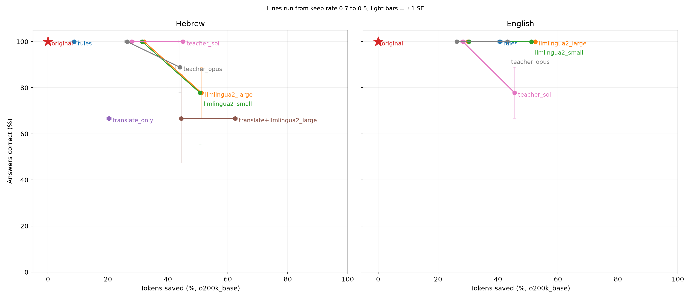
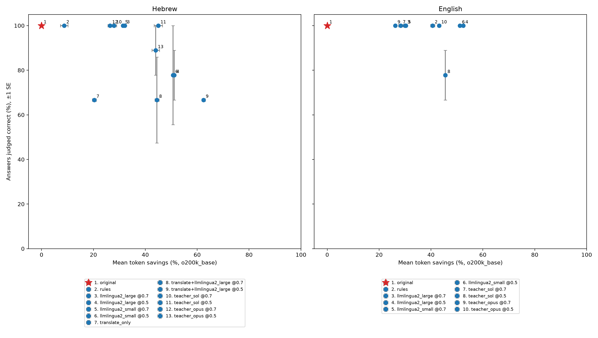
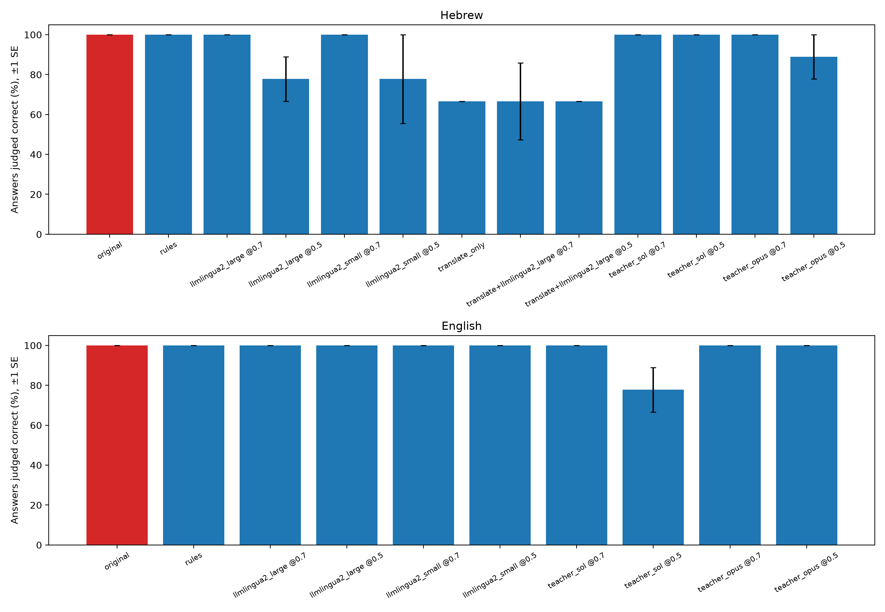
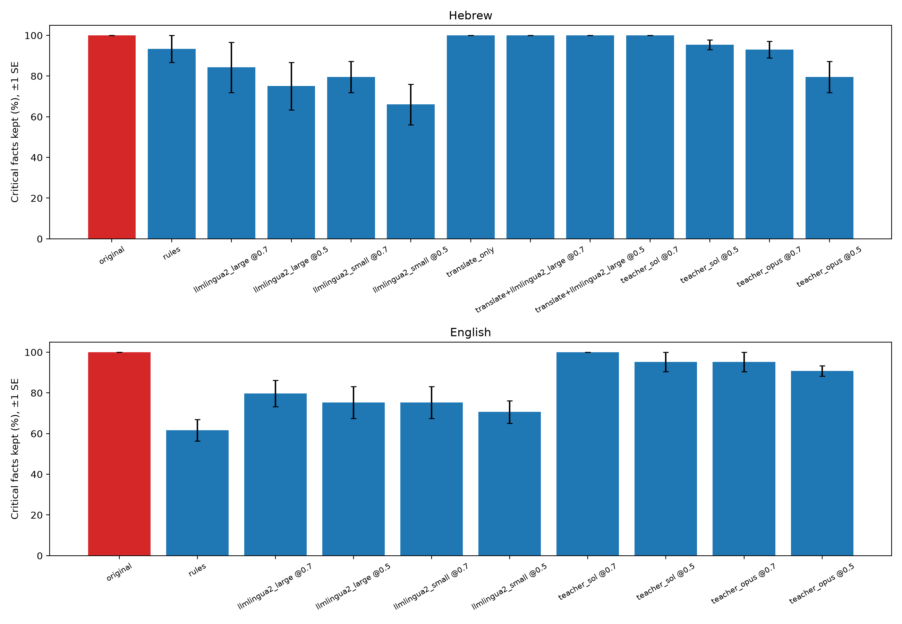

# 03 — Baselines and teachers (Test 3)

## Main chart: tokens saved vs. answers correct

Cases: 3 Hebrew, 3 English. Spec: `notebooks/03_spec.md`. Savings use tiktoken `o200k_base`; error bars are ±1 standard error over cases.

## Hebrew/English token ratio of the originals

- Overall: 1.21 (2818 / 2320 tokens)
- Mean per case: 1.21

## Notes

- facts_kept for translation methods checks digits only and does not detect currency errors (e.g. ש״ח -> dollars).

## (a) Summary

| language | method | rate | cases | savings % | tokens saved per case | accuracy % | accuracy drop vs original | facts kept % | latency ms | teacher failures | JSON failures |
|---|---|---|---|---|---|---|---|---|---|---|---|
| he | original |  | 3 | 0.0 | 0.0 | 100.0 | 0.0 | 100.0 | 0.0 | 0 | 0 |
| he | rules |  | 3 | 8.7 | 89.0 | 100.0 | 0.0 | 93.3 | 1.5 | 0 | 0 |
| he | llmlingua2_large | 0.7 | 3 | 32.1 | 301.7 | 100.0 | 0.0 | 84.3 | 3258.0 | 0 | 0 |
| he | llmlingua2_large | 0.5 | 3 | 51.2 | 480.0 | 77.8 | 22.2 | 75.1 | 3150.6 | 0 | 0 |
| he | llmlingua2_small | 0.7 | 3 | 31.4 | 294.7 | 100.0 | 0.0 | 79.5 | 1238.2 | 0 | 0 |
| he | llmlingua2_small | 0.5 | 3 | 50.7 | 475.3 | 77.8 | 22.2 | 66.0 | 1330.2 | 0 | 0 |
| he | translate_only |  | 3 | 20.3 | 193.0 | 66.7 | 33.3 | 100.0 | 18272.5 | 0 | 0 |
| he | translate+llmlingua2_large | 0.7 | 3 | 44.5 | 420.7 | 66.7 | 33.3 | 100.0 | 21300.0 | 0 | 0 |
| he | translate+llmlingua2_large | 0.5 | 3 | 62.5 | 588.3 | 66.7 | 33.3 | 100.0 | 20759.0 | 0 | 0 |
| he | teacher_sol | 0.7 | 3 | 27.9 | 264.3 | 100.0 | 0.0 | 100.0 |  | 0 | 0 |
| he | teacher_sol | 0.5 | 3 | 45.0 | 430.3 | 100.0 | 0.0 | 95.4 |  | 0 | 0 |
| he | teacher_opus | 0.7 | 3 | 26.4 | 251.0 | 100.0 | 0.0 | 93.0 |  | 0 | 0 |
| he | teacher_opus | 0.5 | 3 | 44.0 | 417.0 | 88.9 | 11.1 | 79.5 |  | 0 | 0 |
| en | original |  | 3 | 0.0 | 0.0 | 100.0 | 0.0 | 100.0 | 0.0 | 0 | 0 |
| en | rules |  | 3 | 40.6 | 317.0 | 100.0 | 0.0 | 61.6 | 2.5 | 0 | 0 |
| en | llmlingua2_large | 0.7 | 3 | 30.0 | 233.7 | 100.0 | 0.0 | 79.7 | 6262.3 | 0 | 0 |
| en | llmlingua2_large | 0.5 | 3 | 52.4 | 406.3 | 100.0 | 0.0 | 75.2 | 6446.7 | 0 | 0 |
| en | llmlingua2_small | 0.7 | 3 | 30.3 | 235.0 | 100.0 | 0.0 | 75.2 | 1939.5 | 0 | 0 |
| en | llmlingua2_small | 0.5 | 3 | 51.1 | 396.7 | 100.0 | 0.0 | 70.6 | 1474.7 | 0 | 0 |
| en | teacher_sol | 0.7 | 3 | 28.3 | 221.7 | 100.0 | 0.0 | 100.0 |  | 0 | 0 |
| en | teacher_sol | 0.5 | 3 | 45.5 | 354.0 | 77.8 | 22.2 | 95.2 |  | 0 | 0 |
| en | teacher_opus | 0.7 | 3 | 26.2 | 201.3 | 100.0 | 0.0 | 95.2 |  | 0 | 0 |
| en | teacher_opus | 0.5 | 3 | 43.1 | 334.3 | 100.0 | 0.0 | 90.8 |  | 0 | 0 |

## Teacher length: requested vs. actual keep rate (words)

| language | case_id | method | requested_keep | actual_keep | attempts | length_miss | teacher_failed |
|---|---|---|---|---|---|---|---|
| he | ins_01 | teacher_sol | 0.7 | 0.7 | 1 | 0 | 0 |
| he | ins_02 | teacher_sol | 0.7 | 0.7 | 1 | 0 | 0 |
| he | ins_03 | teacher_sol | 0.7 | 0.7 | 1 | 0 | 0 |
| he | ins_01 | teacher_sol | 0.5 | 0.5 | 1 | 0 | 0 |
| he | ins_02 | teacher_sol | 0.5 | 0.5 | 1 | 0 | 0 |
| he | ins_03 | teacher_sol | 0.5 | 0.5 | 1 | 0 | 0 |
| he | ins_01 | teacher_opus | 0.7 | 0.7 | 1 | 0 | 0 |
| he | ins_02 | teacher_opus | 0.7 | 0.7 | 1 | 0 | 0 |
| he | ins_03 | teacher_opus | 0.7 | 0.7 | 1 | 0 | 0 |
| he | ins_01 | teacher_opus | 0.5 | 0.6 | 1 | 0 | 0 |
| he | ins_02 | teacher_opus | 0.5 | 0.5 | 1 | 0 | 0 |
| he | ins_03 | teacher_opus | 0.5 | 0.5 | 1 | 0 | 0 |
| en | ins_01 | teacher_sol | 0.7 | 0.7 | 1 | 0 | 0 |
| en | ins_02 | teacher_sol | 0.7 | 0.7 | 1 | 0 | 0 |
| en | ins_03 | teacher_sol | 0.7 | 0.7 | 1 | 0 | 0 |
| en | ins_01 | teacher_sol | 0.5 | 0.5 | 1 | 0 | 0 |
| en | ins_02 | teacher_sol | 0.5 | 0.5 | 1 | 0 | 0 |
| en | ins_03 | teacher_sol | 0.5 | 0.5 | 1 | 0 | 0 |
| en | ins_01 | teacher_opus | 0.7 | 0.7 | 1 | 0 | 0 |
| en | ins_02 | teacher_opus | 0.7 | 0.7 | 1 | 0 | 0 |
| en | ins_03 | teacher_opus | 0.7 | 0.7 | 1 | 0 | 0 |
| en | ins_01 | teacher_opus | 0.5 | 0.5 | 1 | 0 | 0 |
| en | ins_02 | teacher_opus | 0.5 | 0.5 | 1 | 0 | 0 |
| en | ins_03 | teacher_opus | 0.5 | 0.5 | 1 | 0 | 0 |

## (b) Accuracy per question type (%)

| language | method | rate | Q1 numbers/dates | Q2 negations/conditions | Q3 from history |
|---|---|---|---|---|---|
| he | original |  | 100.0 | 100.0 | 100.0 |
| he | rules |  | 100.0 | 100.0 | 100.0 |
| he | llmlingua2_large | 0.7 | 100.0 | 100.0 | 100.0 |
| he | llmlingua2_large | 0.5 | 100.0 | 66.7 | 66.7 |
| he | llmlingua2_small | 0.7 | 100.0 | 100.0 | 100.0 |
| he | llmlingua2_small | 0.5 | 66.7 | 66.7 | 100.0 |
| he | translate_only |  | 66.7 | 100.0 | 33.3 |
| he | translate+llmlingua2_large | 0.7 | 66.7 | 100.0 | 33.3 |
| he | translate+llmlingua2_large | 0.5 | 66.7 | 100.0 | 33.3 |
| he | teacher_sol | 0.7 | 100.0 | 100.0 | 100.0 |
| he | teacher_sol | 0.5 | 100.0 | 100.0 | 100.0 |
| he | teacher_opus | 0.7 | 100.0 | 100.0 | 100.0 |
| he | teacher_opus | 0.5 | 66.7 | 100.0 | 100.0 |
| en | original |  | 100.0 | 100.0 | 100.0 |
| en | rules |  | 100.0 | 100.0 | 100.0 |
| en | llmlingua2_large | 0.7 | 100.0 | 100.0 | 100.0 |
| en | llmlingua2_large | 0.5 | 100.0 | 100.0 | 100.0 |
| en | llmlingua2_small | 0.7 | 100.0 | 100.0 | 100.0 |
| en | llmlingua2_small | 0.5 | 100.0 | 100.0 | 100.0 |
| en | teacher_sol | 0.7 | 100.0 | 100.0 | 100.0 |
| en | teacher_sol | 0.5 | 100.0 | 100.0 | 33.3 |
| en | teacher_opus | 0.7 | 100.0 | 100.0 | 100.0 |
| en | teacher_opus | 0.5 | 100.0 | 100.0 | 100.0 |

## (d) Accuracy drop vs. original per domain (points)

| language | method | rate | insurance |
|---|---|---|---|
| en | llmlingua2_large | 0.5 | 0.0 |
| en | llmlingua2_large | 0.7 | 0.0 |
| en | teacher_opus | 0.5 | 0.0 |
| en | teacher_opus | 0.7 | 0.0 |
| en | teacher_sol | 0.5 | 22.2 |
| en | teacher_sol | 0.7 | 0.0 |
| he | llmlingua2_large | 0.5 | 22.2 |
| he | llmlingua2_large | 0.7 | 0.0 |
| he | teacher_opus | 0.5 | 11.1 |
| he | teacher_opus | 0.7 | 0.0 |
| he | teacher_sol | 0.5 | 0.0 |
| he | teacher_sol | 0.7 | 0.0 |

## (e) Spend per stage and provider ($)

| stage | provider | calls (all time) | new this session | cached this session | tokens in | tokens out | cost $ |
|---|---|---|---|---|---|---|---|
| chatbot | openai | 93 | 24 | 45 | 64834 | 3705 | 0.083 |
| judge | anthropic | 89 | 49 | 0 | 29067 | 8441 | 0.142 |
| smoke | anthropic | 2 | 0 | 0 | 28 | 8 | 0.000 |
| smoke | openai | 2 | 0 | 0 | 18 | 10 | 0.000 |
| teacher_opus | anthropic | 24 | 12 | 0 | 37420 | 228537 | 4.720 |
| teacher_sol | openai | 36 | 12 | 0 | 33630 | 260052 | 2.668 |

## Savings vs. accuracy

## Accuracy per method

## Facts kept per method

